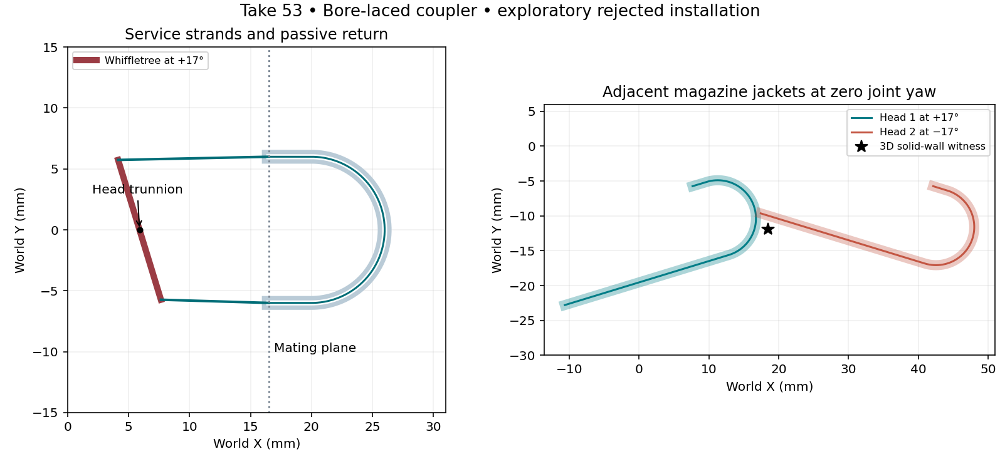

# Take 53 — compact bore-laced draw head

**Exploratory. Reject this installation, not the equalizer principle.** A finite bead train, a positively captured terminal and a trunnioned rocker give a conditional way to bound both leg loads without assuming a frictionless U. They replace the horn and its 16.8 mm carriage. The allocated straight unit bounds to Ø59.599 mm, but two articulated magazines interpenetrate, the passive return crosses its own joint, the open blind meets the feed motor, and guide drag can exceed available draw torque. No complete supported feed, release, power-loss recovery, fabrication, Q12 pass, selection, Gate or official run.

## Datums and furnished interfaces

World mm, +X head to mating tail. Head face x16.50, own tail face x−21.50, pitch 38.00, H=(−5.90,0,0); the next head rotates about H+(38,0,0). Straight stow is one state, not a uniform service envelope. Use the v3 *joint and lugs only*, not its horns, eyes, plates or hood. The two ports at y=±6, z=0 have 3.5 straight legs and an R6 half-turn. Original B1.45 bore and R14 three-site concept were trial inputs. The integrated revision follows Take 52's B1.65 and the lead's newer R13 triangle, clock −90°, with sphere centres at x17.04. Neither is a requirement change. The original R14 plane sites are (y,z)=(0,−14),(±12.1244,7). The integrated three sites are (0,−13),(±11.2583,6.5). At radius 1.85 the ±.93 tangent offsets in the six CAD volumes are only reserves (about 30°, not 60°); actual 60° contacts need lateral 1.602, x16.115; at 65°, 1.677 and x16.258. Finite mating lands, actual load distributions and registry are separate Take 54 work.

The analytic tube has material wherever distance to the U centreline lies between 1.65 and 4.15, away from the end caps. At each port the exact Take 52 ring is a torus of major 2.90, minor 1.25, axis X and centre at local x1.25; the external diameter is 8.30 there, not a solid bore plug. The model uses conservative exterior cylinders/capsules for broad phases (an extra allowance on mouth OD); use the included local input for exact caps. Shell length 25.850 and nominal steel density trial 7.9 mg/mm³ imply 9.30 g straight/curved shell before caps, stays and fabrication seams. No final mass; 70 g is a sensitivity.

## Source checks, not inferred working ratings

| Alternative stock | Published dimensions | Published load, limitations |
|---|---|---|
| [Ball Chain Manufacturing #3 stainless](https://www.ballchain.com/3-stainless-steel-ball-chain-spool/) | 3/32 in (listed 2.4 mm), average 93 beads/ft → 3.2774 mm | Average tensile 25 lbf (111.2 N), **not a working allowable**. The [size chart](https://www.ballchain.com/ball-chain-spools/3-chain/) says 94/ft → 3.2426 mm. |
| [Nissa SB23, MISUMI specification](https://jp.misumi-ec.com/vona2/detail/223303577248/) | Ø2.3, A3.1, SUS305, 10 g/m | Breaking 13 kgf ≈127.5 N; reference use 4 kgf ≈39.2 N in product table but SKU listing 0.03 kN. [AS ONE](https://www.axel-gl.com/en/asone/g/TR61-2100-41/) also gives 0.03 kN. No transfer to American #3 or this bent, cycled, positively driven terminal. |

Neither source specifies compressed pitch, permitted swivel cone, connector diameters or head construction, bore fit of the terminal, connector stiffness, repeated bending, sealed sprocket torque or service in a contaminated return. No such source limit was found. Gauges r1.15..1.25, stretched pitch ≤3.40 and connector contained in the R.35 capsule are **provisional**, not a purchased tolerance. A smooth crimped last bead is custom; the ordinary keychain coupling is not it. Gauge tensioned, compressed and obliquely loaded specimens across lots; inspect severed shells, seam, swage and pin. The following angles are *demands* from sourced pitch, not assurances of articulation.

## Positive supply, catcher and recovery

* Feed in neutral: a mechanical centring fork must index the rocker; the slide-mounted upper feed train engages a face clutch concentric with the trunnion. Two bevel stages and an 18:32 spur drive a ten-pocket wheel, R5.303 at 93/ft. A source shoe and finite chain remain captive in a folded, rounded track on one arm. Smooth last ball follows a temporarily closed half-tube across the face, through the passive U and back in a second half-tube to the hard cup on the opposite arm. No moving, timed or actively indexed tail element.
* Pocket trial: make spherical R1.37 relieved cuts at each pitch-circle centre in a Rp+1.02 wheel blank, with a ≤R.50 connector groove. Keeper covers the rear half-turn between Rp+1.40 and Rp+2.08, backed by side covers; radial crest-to-keeper .38 < minimum ball diameter. Midpitch nominal tooth-to-pocket reserve .289 before the connector groove. The JSON blank is a machining allowance, **not** a certified tooth. Centre angular steps, nominal/3.40 gauge: R6 31.70°/32.92°, wheel 36.00°/37.40°, magazine R5.48 34.80°/36.14°. U chord sagitta ≤.246. Five pockets accumulate .174 mm disagreement even between the two US averages, or .613 mm for the 3.40 gauge versus nominal. Neither a five-ball rigid mesh nor a positive, non-jamming compressed feed is established. Force-limited wheel reversal, continuous support through both joints and actual pocket dwell under pitch variation must be tested; a stalled free tip can compress the intervening chain.
* There is one storage track, with twin temporary feed throats at the joint. Free-tip centre parks **3.42** behind the head face, behind the physical port blind: max ball is .40 behind its back. Straight feed from that location to the catcher at zero draw requires about 39.270 mm = 11.982 nominal pitches or 431.35° of wheel, assuming path-length transfer with no elastic loss. Magazine centreline length 43.916, but its full length is not usable stroke. Trial 20-interval length 65.548 mm includes five pitches on the wheel; stop the shoe with its terminal nose at the *lower tangent*, the opposite tip in its cup. An oversized captive shoe/shoulder and a positive wheel key on the arm restrain the permanent end; a source-side collar can seat the upper-tangent bead to locate its outgoing line. All intermediate returns remain on that arm. A free wheel or unlocated last tangent does not furnish a direct point load. Shoe nose, shoulder, pockets and swaged terminal need a single coordinated pitch datum.
* Taking the arcs at nominal centreline lengths (not a chain toolpath), the remaining straight-U-straight run at no draw is 45.850. Tightening the 20-interval cut ideally takes 1.656 mm common slide from a 2.40 stroke; home shoe reach 42.581, leaving only 1.335 for nose/end clearance. At p3.10 the same model gives u=.325 (below the .60 service reserve); at p3.40, u=2.575 (>stroke), and home shoe reach exceeds track by .504. Thus **no common cut presented for arbitrary stock/gauges**. Chord correction, slack accumulation and oblique insertion are unresolved. Integer pitch plus final continuous draw is not permission to stuff one surplus bead against a bottomed tip. A feed-position stop gauged to the actual cut, positive cup/pickup interlock and adequate unload reserve are prerequisites.
* Two .50-thick tines at y offsets ±.95 straddle the neck. At touching Ø2.50 balls the gap available at that offset is .875 (vs .209 at ±.50); a .50 tine can enter at the centred slice. At radius 1.15 the unilateral radial overlap is only .20. Net one-tine gross shear area proxy .648 mm² gives 46/94 MPa at 30/60.62 N before bending, seam collapse, edge failure or prying. A driven transverse collar fork goes behind the bead and a separate square blocking dog prevents reverse fork travel. Neither closure nor load holding may depend on a spring. Allocation presently has tines in the closed state, not a cleared, manufactured sliding fork/lock stroke. Both collar heights and the carrier just behind the wheel need redesign for transfer with the true terminal and any compressed phase.
* Before tension, both split feed throats open in ±Z by 3.30, drive clutch opens by nominal .29 axial gap; centring actuator must completely withdraw. After service, screw takes back load, unloads the 24-slot mechanical screw key under control, advances to relieve the loop, and neutral centring fork, closed throats and wheel clutch re-engage. Back-drive the positively geared receiver latch, positively recover the free terminal; only then slide metal blinds across both bores and drive the two annular pusher faces plus third pad 1.55 in +X. Fork lies ≥6.905 behind the face but burial alone does not prove inaccessibility through an open bore. The blind is a physical blockage, not an encoder: clearance and physical transfer interlocks, full backing, flush outer face and sharp-edge shielding need redesign. A jammed strand may defeat blind closure or be severed; no ejection credit in that state. The two-lip obstruction from Take 52 has throat 2.0105 <2.30: even rounded surfaces can trap the smooth last bead. No arbitrary-attitude escape or post-discharge non-recapture proof.

## Equalizer, angularity and loads

Pivot (6.5−u,0,0), arm halfspan 6. At yaw t, endpoint X offsets ∓6sin t, Y offsets ±6cos t. For D≥10, differential straight lengths are hypot(D+6sin t,6(1−cos t)) minus hypot(D−6sin t,6(1−cos t)). At ±17° this spans **±3.507 mm**, sufficient for a differential ±3.40 pitch; each arm only travels ±1.754 in X. It is **not** ±one pitch independently per arm (that would need 34.52° projected). Common screw stroke changes both lengths continuously, about 4.8 total. A separate 4 mm radius peg and tangent ±20° stops give .209 nominal clearance at ±17° (.109 after .10 combined debit). Stop strength, total loaded deflection, shift of post locations and actual differential demand remain open; do not apply the balance on a stop.

At ±17°, nominal geometric angle at D=10 is ≤1.83°. With .60 minimum slide retraction, .20 longitudinal debit, .10 joint and .08 seat transverse errors, and free entry centre wander B−1.15, the worst independent angle is 4.91° for B1.45 and 6.22° for B1.65. These are bounds on the *taut unsupported line*, not source-certified connector angularity or a statement that a piecewise-contact polygon is straight. Use 6.7° for the parent load sensitivity, **not 3° unless measured**. The take-up stage needs the true line to pass through the specified seat within .08 perpendicular. Provisional 3° over the 3.5 entry plus .10 and .08 errors needs R1.613; B1.45 cannot pay that budget. The wider bore trades bend-entry fit for increased load-line freedom.

For a free rocker, net service moment about Z gives |h₁T₁−h₂T₂|≤M, hmin=6cos(17°+β)−.08, hmax=6+.08. For total axial draw F: F≤T₁+T₂≤F/cosβ, Tmax≤(hmax F/cosβ+M)/(hmin+hmax). Ratio ≤(hmax+M/(F−Tmax))/hmin. No capstan equality. At β=6.7°, M=5 Nmm and F=55.5, hmin=5.414, max leg ≤30.00 N, ratio ≤1.160; at F=113, ≤60.62 N and ≤1.141. At β=3°, M=.5 and F=39: ≤20.45 N, ratio ≤1.099. M includes **all** clutch/guide drag, harness, gravity, bearing friction, rotor inertia and disturbances; .5 and 5 are trial caps. For reference only 51 g·mm off-axis under gravity consumes .5 Nmm in an adverse attitude, even before bearing drag. Measure loaded moment, do not borrow it from a bearing catalogue.

The head-side service strand prism encloses the two line segments at all θ,u within the stated datum/centroid errors; dilate by r1.25. Outer land columns rather than the old diagonal face bridge are necessary. With split throats withdrawn and blinds open, separation from listed fixed and slide stock is ≥.170 mm before stock/tolerance/elastic debit; the nearest are the draw-bearing straps. All force-bearing guides upstream of these loaded segments are on the rocker. A .20 clearance allowance would exhaust this margin. Moment bounds are **conditional** on no additional seat lip, stop, fixed guide, collar-drive contact or compression; a collapsed bearing or snag removes them.

The parent's 70 g static screen at R13, 38 pitch and this clock, 6.7°, ratio≤1.22 needs 55.5 N at 60° normals but 113 N at 30° normals. Not reproduced here and not a measured installation rating. Prior near-equal 39 N and one-side ≈184 N used different assumptions. The one-side case means a leg may carry essentially the full 184 N, **not** the equalized 98.4 N diagnostic in the raw output. This exceeds even the #3 average tensile figure. At 113 N the equalized 60.62 exceeds both SB23 reference-use listings. Even the 55.5 case approaches the lower 30 N reference, with no fatigue, impact or terminal factor.

## Actuators, force path and retention

Three head motors (feed, draw, sequencer), plus the retained joint. All head reserves Ø6 × 32.8. [FAULHABER 0615 3 V](https://www.faulhaber.com/fileadmin/Import/Media/EN_0615_S_FMM.pdf) rated .156 mNm, [06/1 steel gearhead](https://www.faulhaber.com/fileadmin/Import/Media/EN_06-1_FMM.pdf) 25 mNm continuous, 35 intermittent, 256:1 with motor 32.3±.5 and max 60% gearbox efficiency. In Nmm the rated motor times that **maximum** gives only 23.96, before mounting, duty and enclosure effects. Comparing gear rating alone is wrong. 64:1 gives ≤6.99 at 29.6 length. Bare 06/1 radial rating .5 N at 3.5 overhang, not 5 N (the longer K version). 11.83 Nmm on an R2.25 pinion implies 5.26 N tangential; the pinion needs a separately supported quill, not an overhung motor shaft. Gear tooth form, pressure angle, bearing packaging, cables and heat unresolved.

| Input sensitivity | Nominal idealized result; not capacity |
|---|---|
| Feed thrust 2/4/8 N | Rp5.303 wheel 10.61/21.21/42.42 Nmm; geared input 7.95/15.91/31.82 at 18:32 and .75 external efficiency. No measured jam force, pitch retention or cap. |
| Draw total 55.5/113 N | Always-engaged M3×.5, trial thread efficiency .28 and overall external mesh .75: screw 15.77/32.12 Nmm, 18:32 gear input 11.83/24.09 **before** carriage binding or bearing loss. |
| Closed screw index | Frictionless axial backdrive bound at R3 gives 1.47/3.00 N radial-key flank tangential reaction; design for full driven/jam torque, not just this ideal. 24 slots, forward-only registration adds ≤.02083 slide (.04167 paired length); needs compliance and force cap, and positive dwell backing. |
| R3.8 wheel key if source sphere clamp fails | At high leg 30.00/60.62 N: 41.86/84.60 N flank; size independently of normal low feed torque. Key acts on rocker, not electric brake. |
| Strip test 3/6 N | 1.55 mm cycloidal rise in 70°, .65 cam efficiency, 18:31 at .8: gearhead 8.50/17.00 Nmm. One R6 pad jam gives 18/36 Nmm and ≥4.09/8.18 N couple over 4.4 guide span. Not evidence the neighbour physically moves or releases. |

Critical **eccentric draw load**: screw z−10.25 vs force at 0, guide at +3.40. Opposed shoes nominally 3.50 apart; 2.90 between closest land edges. For total F and drag D, opposed normal couple = (10.25F+13.65D)/L; D=2μ times this in the symmetric two-contact Coulomb screen. At L3.50, μ=.05 increases thrust by 1.480, raising the 55.5/113 N input to 17.51/35.65 Nmm; μ=.10 gives 43.33/88.21, and .15 does not exclude self-binding. At L2.90 and μ=.10 the same screen reaches 154/315 Nmm. These are model sensitivities, **not** measured coefficients or guaranteed forces. Locate the screw near the force line or use symmetric supports, not a motor upgrade alone. The hollow trunnion and the tab that transfers the offset couple, concentrated face columns, frame fasteners and shoe/bearing pressure are not rated.

Service load path: free terminal → driven fork and independent blocking key / permanent-end shoe and keyed wheel → rigid rocker → hollow Z journal → nut/slide and opposed shoes → screw/thrust races and 24-slot positive key → frame → six metal seats → passive U. Use active take-up only to reach a measured direct axial force; transfer and release under screw control. A strain element at nut/slide sees guide drag; it does **not** directly measure loop force. Calibrate both directions, use independent travel/overload trip and physical overrun without a hard bypass; no specified stiffness, jam force, slip torque or stroke qualification. The positive index and fork closure are proposed structural load paths, not friction-only locks. The indexed closed state, power loss between key events, vibration arrest, reversible latch sequencing and cam detents are not proven. The model includes support/actuator reserves rather than implying that an omitted cam or sensor exists.

## Two modules and rejection witnesses

One module includes own passive U, actual v3 joint/motor/lugs, three full-length head drive reserves, feet, cell 30.66×20.7×5.40, MCU 22×17.8×5.7, driver boards, connector and wire reserve. Search uses a deterministic orthogonal grid and grouped 3D sweeps. Conservative support of each listed closed solid about (−.86233,.22800,−.81313) gives diameter **59.5984**; floor z−23.50. This is an *upper bound for listed stock*, not material fit, and excludes many unsized items (frame skin/fasteners, wiring bends, load element, actuator details, sleeves, seals and service radius). Only .201 radial allowance remains. Earlier V1/R1.45 long rocker and shorter 28.7 motors gave Ø58.037 but the rotating motor crossed the sequencer shaft; superseded.

1. **Same module.** At (−8.52,0,0), distance to passive-U centreline 3.48, to central R3.10 joint axis 2.62. An R.269 ball lies inside both the tube wall and joint stock even for a central through-bore of radius 2.35. This holds for either B1.45 or B1.65. No credit for a hollow bore where wall actually meets the joint. The refined stroke-neutral feed motor additionally crosses the open blind crossbar, R.1517 common inscribed ball at (14.8717,−5.8483,7.6983).
2. **Two heads.** Each magazine has true inner R1.90, outer R2.24 wall, not a filled keepout. At zero joint yaw, u=.60 on both heads and opposed +17/−17° rockers, upstream curved wall meets downstream straight return at (18.46617,−11.93619,−9.76401). Common 3D ball R.16974. At −15° neighbour yaw, upstream +17 and downstream neutral, u=0, another R.16983 witness occurs at (18.76598,−12.25149,−9.38924). These are points in allowed trial ranges, not proof a service load actually drives both extremes. Fully aligned indexed neutral magazines are not declared jammed. Broad checks cover yaw ±15, draw and strip; only the positive common interior certificates establish collisions. Held and freely displaced neighbours, dynamic ejection, two-mouth trap accessibility and a continuous cleared recovery path remain unresolved.
3. **Range and reaction.** The 3.40 pitch gauge already exceeds both this magazine's parked length and 2.40 take-up for the illustrative 20 intervals. The short, offset draw guide may bind or overload. These are independent of sphere-centre optimization or the intersecting shafts.

If revisited: first measure actual bead/terminal pitch, loaded connector-force line and bend/return loads. Keep storage *fixed and physically disconnected from both service arms* after positive end transfer; place the U clear of its own knuckle, guide the axial screw through the tension plane and ground all contact moments. Re-run paired stock, real facing lands, jammed/unequal load, shutters and all attitudes before any retention or release claim. No run, candidate, PR, commit or push.
