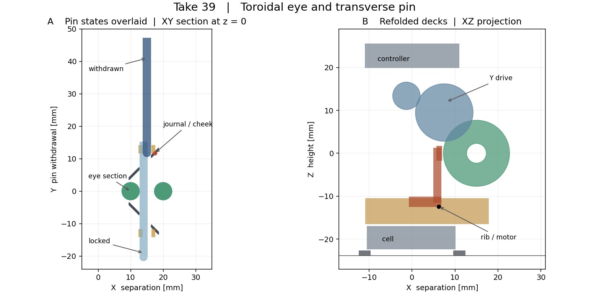

# Take 39 — transverse pin through a central toroidal eye

**Disposition: reject the three Y-pin installations drawn here.** Relieving the pin carrier across a fixed flared cheek puts a journal through the cheek. Moving the drives to opposite decks removes the original pin/motor collision, but puts the independent ejector rib through its own motor. Neither conflict depends on pitch, yaw, motor torque or friction. This is a rejection of these layouts, not of a toroidal eye or the 60 mm class.

**Result label: exploratory.** Q12 / ENV-004 / Q85 / Q100 unchanged. No candidate, acceptance run, dimensions of purchased parts, or physical test. All coordinates in mm; X separates, Y withdraws the pin, Z is up. The pre-existing joint is about Z at (−6.5,−7.8). The sections below illustrate the witnesses; the numerical tests use 3D bodies.

## First discrimination: material common to two parts

| Layout and state | Common point in the first Kin's coordinates | What it proves |
|---|---|---|
| Retained eject drive, pin locked | (13.95,−15.37,0) on the pin axis | 1.650 inside the Ø6 motor cylinder about (12.60,−15.37) in XY. Not clearance between outer boxes. |
| Fixed cheeks, relieved, pin still captured | (17.45,11.70,0) | Radius 2.45 in near race annulus (trial ID 2.70, OD 5.20). Beyond slot end x16.35, between wall faces y11.42 and 12.17. A real intersection. |
| Both lower-X refolds, ejector parked | (6.20,0.75,−12.40), strictly within the ejector rib | 0.585 inside Ø6 motor about (y,z)=(2.90,−13.50), within both proposed motor lengths. Motor shell material is not modeled in detail; the required rib enters its occupied body. |
| First lower-X refold, pitch 36, +15° yaw, eject 15, neighbour departs 1 | (21.70,0.73,−12.45) inside advanced rib | 1.934 inside the next Ø6 motor allocation. At pitch 33 the same incursion occurs with eject 13 and departure 2. These are independent recovery poses, not imposed joint trajectories. |

## Operating sequence and section

* Eye centre (15,0,0), major R5 in XZ, minor R2.70; foremost head-facing crown x7.30 and opposite crown x22.70. A rounded +X neck and three registry balls are separate from the torus. The eye does **not** translate by command.
* A Ø2.50 Y pin with hemispherical tip takes up on the eye at carrier x13.95, pin metal x12.70..15.20. The relieved centre is x15.00, metal x13.75..16.25. For a centred stationary eye this leaves 1.05 radial play; it does not ensure loss of real load. Two metal journals at |y|=11.65..14.15 travel with the carrier, linked by side arms and an aft tie. They do not clamp the eye in Y.
* The X draw pulls the eye against **six external seat faces**, two per R2 registry ball: centres at x19.20, radius 9 about X, phases 90°, 210°, 330°. Each V has two normals inclined ±45° tangentially from +X. The smooth torus alone has no normal torque about its Y axis. The six normalized nominal registry wrenches have determinant −6.75; rank is not a unilateral preload, strength, friction or stiffness proof. No equal sharing assumed. Closing path is pin → eye/neck → indexed balls → seats/ribs → metal frame/carrier/spring seat; the shell cannot carry preload. A closed metal frame with adequate sections is **not** established.
* Y-screw and roller-cam proposal: advance powered cap in −X, load a series spring behind the carrier, stop on calibrated torque/force rather than an absolute position. Reversing pays out the spring, then a positive shoulder returns the carrier before the pin leaves its supports. The spring cannot close an unpowered open coupler. The independent X drive is for forward ejection only.

| Nominal state | Carrier X | Y tip apex | Y straight-shank start | Y rear end |
|---|---:|---:|---:|---:|
| Drawn | 13.95 | −21.55 | −20.30 | 15.25 |
| Spring paid out, carrier relieved | 15.00 | −15.55 | −14.30 | 21.25 |
| Withdrawn | 15.00 | +10.50 | +11.75 | 47.30 |

The first 6.00 of Y travel leaves only 0.15 of straight-shank extension beyond the far journal's outer edge. The next 26.05 withdraws the pin. Normal clearances of the actual tip to the near wall's inner and outer planes at terminal are 0.716 and 0.185; the latter is below a 0.20 allowance. The rear link reaches y47.85 **deployed**, not in stow. At pitch 33 the open pin end and the own tail's opposite crown alone are 62.400 apart. A fixed tower to the rear endpoint cannot be hidden in a 60 mm sphere.

**Fixed vs moving cheek.** The fixed design uses inner |y|=x−6.03, outer 0.75 farther in Y, slot x12.60..16.35, z±1.35. At x13.95 the inner face is |y|=7.92. At the relieved journal's forward OD a flush uncut wall requires |y|≥12.52 with 0.20 Y reserve; the inner race face is 11.65. Translating a local port panel +1.05 with the race shifts the wall planes away from the reported common point and permits a circular bore instead of a long slot. It creates two travelling seams and requires backing/overlap over the stroke; the far-rim diameter and eye/registry access must also be rechecked. A bare journal recessed into a hole isn't a positive-draft wall. No closed seam, supporting fasteners or release credit for the moving-panel alternative.

## Withdrawal under load

At each straight slot section the short Z half-width is 1.35: making the hole long or elliptical in the plane does not increase its inscribed-circle radius. For the **tube alone**, asin(1.35/2.70)=30° possible rim-normal deviation. From a 45° wall this leaves 15° before manufacturing error; with a further 1° and provisional friction 0.23, forward contribution is only +0.01875 N per normal N. For R2 registry balls the same screen is **−0.20294**; R1.15 spokes cannot span the slot. It is invalid to extend the bare-tube result to the full tail.

The long pin permits a **37.814° bare-eye, two-contact configuration** along a continuous tilt about Z with the rear core held at (10,0,0); both corrected flares admit the tube. Opposed contacts are 6.131 apart along Y. This geometry is neither proof of infinite drag nor proof of release. On precisely that path, at ±20°, the wall points (16.20,±10.545,−4.60) already lie **1.747 inside** the corresponding R2 registry ball. Contact elsewhere can supply a wrench; obstructing this one path neither excludes other two-point poses nor provides a load bound.

Ø2.50 pin, nominal steel E=205 GPa, simple supports at ±12.90 and a single 85 N central transverse load: M=548.25 N·mm, 357.4 MPa bending, 0.0774 deflection. Centred reactions follow equilibrium **only for that ideal load**. After the far race ceases supporting: apex −11.60, shank starts −10.35, far forward rim (16.35,−10.32,0) still sees the shank. Even a perfectly fixed near clamp at y11.65 gives 0.003122 mm/N compliance at that rim. With 0.10 radial clearance, contact starts at 32.03 N.

| Load at y0 | Deflection without rim | Ideal rigid rim X reaction | Near clamp force / bending moment |
|---:|---:|---:|---:|
| 50 N | 0.156 mm | 6.24 N | 43.76 N / 445.38 N·mm |
| 85 N | 0.265 mm | 18.39 N | 66.61 N / 586.14 N·mm |

Reactions enforce deflection compatibility, not equal sharing. The 50 N case alone adds 1.44 N axial Coulomb drag at a hypothetical X-normal rim with μ=.23, **before** near-guide friction. Unknown rim normals, clearance in the 2.50-long near race, hemisphere contact, wear and lateral load direction make these a sensitivity test, not an upper bound. The far port is an extra rubbing support, not a jam-proof guide.

## Drive, power loss and independent forward stroke

* Refolded Y spindle axis (x,z)=(7.50,9.50), geared motor at (−1.30,13.40); lower X eject screw (y,z)=(−6.20,−13.50) and motor at (2.90,−13.50). Moving cantilever link actuates the pin without a permanently projecting tower. Distinct cell, MCU, joint motor, motor drivers, power/socket and sensor allocations count in stow.
* At assumed spring rate 45 N/mm, 65 and 85 N take 1.444 and 1.889 compression, plus the 1.05 carrier take-up. The 3.2/6 cam has excess travel: limiting force is essential. At nominal 85 N, illustrative cam/guide and thread assumptions demand 76.42 N Y, 32.18 N·mm at the spindle, 24.85 N·mm at the gearmotor. No continuous/start rating, fault limit or adequate preload for external table loads is established.
* Trial metal 12-notch reverse dog on the Y spindle drum, OD12.6 near y−20; pawl and separate lifter behind wheel. One tooth pitch pays out 0.020 axial spring travel, 0.90 N, under the nominal cam law. Intended release: motor supports load before lifting dog. The drum/pawl envelopes are charged; tooth stress, actual engagement under a torque stop, lifter force/stroke and power-loss sequence are **not** proven. Fixed end pads physically limit the refined pusher crosslink; they are not force sensors. Optical pin target at y14.75 can distinguish direct pin markings; separate spring-unload pickup and eject switch monitor actual parts. No sensor or motor endpoint proves tail pose, force isolation or physical departure.
* Raised pusher face x7.05 parked leaves 0.25 axial gap to the aligned crown. The first refold advances 15; final branch advances 13 to **x20.05**, 1.45 past the fixed x18.60 mouth if aligned contact is maintained. No arbitrary-orientation pickup or positive terminal separation proof. A 15 N corner force is eccentric by 17.15 mm: 257.28 N·mm moment, 57.17 N opposed guide-reaction sum across a 9 mm shoe, 28.15 N screw demand with assumed μ=.23 (before coupled friction). Nominal 9.69 N·mm screw, 5.96 N·mm gearmotor. This is required capacity, **not** demonstrated delivered force. The actual parked rib/motor interference rejects this stroke mechanically.

## 60 mm, floor and ±15° adjacent heads

| Layout | Straight locked-stock sphere, not assembly feasibility | Neighbours / joint |
|---|---|---|
| Original Y drive + retained ejector | Ø60.908 about inherited (−0.20,0,0.15) | Closed/open head endpoint tests at pitches 33/36 did not resolve the same-head and own-joint failures. |
| Y drive above, X ejector below | Ø59.143 about inherited centre, unguarded inventory | Front bush and next web share material at pitch 33, zero yaw. Next motor enters extended rib also at pitch 36. |
| Shorter lower drive, guards, spring and dog | Ø61.528 about inherited centre; **Ø59.665** about (0.095,−1.482,−0.1195), both pitches, full counted stock | Pitch 33 unseparated at all C/C, C/O, O/C, O/O endpoints. At 36 the respective neighbouring head-only separation bounds are **1.288 / 1.288 / 0.253 / 0.253** after reserve. Own yawing sector vs wheel guard remains unseparated by 0.813. |

The last branch shifted the lower transmission +3.9 X, shortened its front bush/rails and put a metal bridge aft of the seats. Its Y spindle still crosses the **series spring allocation**; thread/nut and guided shoe/rail outer overlaps are intended fits, not material witnesses. The corrected guard/sector and some other negative screening numbers are **failure to separate**, not penetration depths. The two same-head material witnesses above remain at pitch 36. A nominal 0.167 radial stow margin is not evidence that a physically assemblable shell, stops, wires, axial bearings, load-rated supports and tolerances fit. Actual 60 mm stow is **not established**.

Four trial feet at (x,y)=(±11,±7): floor z−23.50 originally, −23.80 in the final branch, including deployment. Lowest final non-foot stock z−23.05; axial ejection and yaw about Z do not consume that nominal 0.75 vertical clearance on a level plane. This says nothing about tilted floor, tipping, traction, stable gait, tail contact, or reaction of the 15 N pusher. A free grounded 70 g unit with a 12.4 mm lever has only 8.5 N·mm gravitational restoring moment against 357 N·mm from a horizontal 15 N external load 23.8 mm up.

**Method and reproduction.** Python 3 standard library. In the included studies directory run each of `eye-pin-take39.py`, `eye-fold-take39.py`, `eye-recovery-take39.py`, `eye-witness-take39.py` with `python3 -B`. The shared Take 28/32 helpers are in the neighbouring cand-d-transverse-vise directory. Solid projection tests include oriented cylinders, capsules, finite hulls, 0.20 stock reserve and finite half-step yaw debit; a torus chord capsule includes its sagitta. A positive separating projection suffices; failure on a finite axis list doesn't prove collision. Both head orders use independent locked/withdrawn endpoints, yaw −15..+15° and swept ejection/departure, not arbitrary intermediate pin poses or all three-body contacts. The explicit point tests are independent of that screen. No further redesign or official test is part of this package.
