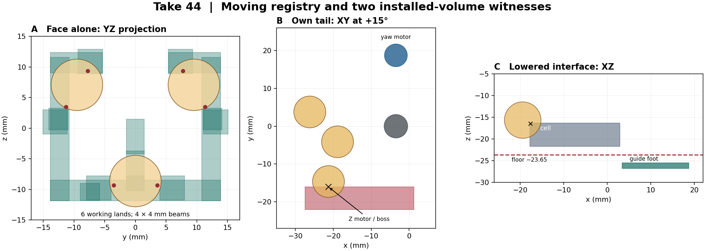

# Take 44 · tapered button and moving three-boss registry

**Result label: exploratory. Reject the two actuator installations, not the joint, local guard or button family.** The metal joint fits beside the larger articulated tail; a forward-set moving face can pass the button and its root sleeve. Neither implies an achievable Ø60 complete machine. The routed Z motor hits the own boss and neighbouring registry, the X guide is overloaded in nominal yaw, and the finite hood and drive occupy the same material. Lowering the interface is not a drop-in fix.



## Coordinate contract and method

Millimetres, newtons, N·mm. Head-local X is forward/ejection, Z up. Mated eye centre (15,0,0), R7.50/r4.20 in XY. Three r4.20 bosses at (16.57,0,−8.65), (11.54,±9.526,7.07); six supplied poles, projected radially onto the exact balls before constructing their tangent pads. Own tail at straight pitch p is translated by (−p,0,0) and articulated about the **fixed** Z axis H=(−3.50,0,0). The central stem is Ø4.40; three Ø4.0 necks are explicit. The final upper necks start on the ring at ±65°, rather than passing through their working poles. The split fork has Ø2.90 branches, individual ends, annular hinge lugs, hub and sector.

Baseline world = local. Offset comparisons use world = local + (0,0,k) for **all** head/roof/button/guide/motor/face and tail ring/boss/neck/stem stock. Reconnect both fork branches between shifted stem and unshifted lug. Hinge, sector, feet, cell and boards stay fixed. No off-grid support. For adjacent bodies apply the same shift in each body. The mated interface itself does not yaw ±15° at the seated register: the joint of each body articulates behind its tail.

The solids are convex hulls, optionally expanded by a ball or axial disk. Ring arcs use ten-degree capsules expanded by the circular sagitta. Sector annular pieces conservatively enlarge outside stock and shrink holes. The linear sweeps take the entire translated hull. Finite-axis separating projections certify positive clearance, **not** penetration on negative results. The 1° own-tail and 3° neighbour grids debit the nearest angular sample error plus .20 stock; direct Z separation has no yaw error. The four neighbour recovery combinations (CC/CE/EC/EE) use X sweep enclosures and up to +16.8 separation; these over-approximate possible states. Hard collision results below instead exhibit points at specified simultaneous poses, including zero separation. All “after allowance” gaps are geometrical, not built tolerances, deflection budgets or acceptance margins.

## 1. Own joint and static torque

Two stacked layouts place a Ø6 × 28.70 gearmotor away from the eye. Baseline motor axis (3.70,13.35), compound axle (−3.50,11.25). At p35 the main stem/central knuckle is unseparated (−.098 after debit), not a material witness. At p36/37.5 all non-mating tail/joint pairs separate; the old lower bearing/sector pair has .050 remaining. The corresponding eye/boss/neck-only margins are 1.765/2.921. This removes the previous unavoidable eye-through-own-yaw-motor contact for these geometries.

The final tucked variant moves the motor to (−3.50,18.75) and swaps the two gear layers. Module .25: 18:42 at 7.50 centres, rigid common shaft, 18:72-equivalent sector at 11.25 centres. The sector spans 63..117°, so a ±15° yaw leaves 12° tooth coverage at each end. Pitch radii 2.25/5.25 and 2.25/9.0. Ø3 pin through 3.14 bores; metal annular lugs, central knuckle, frame pillar, return elbows, two compound bearings, nose bush, U gear plate, motor saddle/strap return and bearing bridge. Lower reaction plate 1.20 thick; sector and gears 2.20 wide. Pin/bores and working tooth mesh are intentional pairs, not clearance results. Coaxial fits need a separate tolerance stack; teeth use OD stock, not manufactured profiles. A thin nominal lug/hub junction needs a monolithic fillet. Gear play, cut teeth, bolts, keys, metals, lead-in, bearing seats and quill alignment are not qualified.

| Pitch | Tucked joint versus full own tail | Joint, tail, electronics, feet: enclosing Ø | Static joint torque | Required gearhead torque |
|---:|---:|---:|---:|---:|
| 36.0 | +.118, pin versus fork end | 58.775 | 112.37 | 15.05 |
| 37.5 | +.118 | 59.495 | 115.46 | 15.46 |

Static screen only: two followers plus own unit at 70 g each; friction ≤1 with the **whole** normal force placed at the worst foot radius (18.566); no equal foot sharing. Bound is 0.070g(3p+3Rfoot); gearhead demand divides by (42/18)(72/18) and provisional .80 total external efficiency. At p36 the sector needs 12.49 N tangential, the motor pinion transmits 6.69 N at the assumed input torque. For provisional 20° pressure angle, corresponding radial forces are 4.54/2.43 N. Dedicated nose bush and straddled compound axle must react these, not a free cantilever on the gearhead. The [Maxon GP 6 A, 472229 comparator](https://www.maxongroup.com/medias/sys_master/root/9406823596062/Cataloge-Page-EN-412.pdf) lists 30 N·mm continuous gearhead output, max .60 efficiency and 8 N radial at 5 mm, not delivered motor torque or an assembly rating. A .324 N·mm motor operating point would need ≥.210 motor-to-gearhead efficiency at 221.34:1. No proof of hot start, compound tooth stress/life, driver current, yield, dynamic loads, 70 g mass, balance or power budget.

## 2. Registry, force path and guide

The final local face is `face3()`. Six tangent pads, 2.40 × 2.40 × 1.10 except two 2.00-square inward corners; backing Ø2.90 (two Ø2.76); **4 × 4 mm metal beam** from x5.12. Trial homogeneous machined steel beams and webs, not PA12 tabs. Upper/lower crossmembers join the outboard posts; bottom bridge x5.05..7.60, y±13.85, z−11.90..−8.50. Forked stripper reaches x3.05 with a .25 nominal gap to the rear torus crown. Recessing its lower shank and dog-leg return clears the yawing sector without cutting through a hinge mount. End fillets, attachment, heat treatment, allowable stress and mass are unresolved.

Nonworking stock stays ≥.240 mm from the **exact** aligned torus at take-up; ≥.371 from non-mating boss/stock pairs; ≥1.570 from the routed necks/stem. Full −1.50 relative X relief/inverse pickup gives ≥.218 nominal to any nonworking surface, including both angular and axial sampling debits; deduct .20 stock separately. Six intended contact pads have positive-X normals and move backward through their supporting half-spaces on relief. These are aligned-path results only.

With the provisional **floor-only** guard, final moving face against button/sleeve, both routed drives, fixed joint and electronics: +.100 at relief/lift, +.0241 during ejection after allowance; versus own articulated tail +.0642 at both pitches. This is a useful space for the registry, **not** the drive/guide or Take 43 complete hood. The full face advances to +16.80; the six lands move forward with the central stripper rather than becoming the fixed barrier found on Take 42. In aligned physical contact the stripper plane ends at x19.85 versus the original eye rear x3.30 (potential 16.55 displacement even without preload); the guard fore end is x18.40. This implication requires real crown/pad contact, blocked reaction control, sufficient force after losses, and measured separation. It is not a free-tail trajectory or proof that a loose/off-axis eye cannot bypass the finite face.

Force loop: powered M3×.5 take-up → anti-backdrive toothed nut rack → *metal* series stack/bridge → rail-backed spar → instrumented metal stalk → integral face, seats and bosses → eye/button/sleeve → frame. Stalk downstream of guides, 3.20 × 2.80 section, no parallel path credited. Use measured **total face Fx=64..76 N**, not screw current or estimated spring compression. Nominal 76 N frictionless central pure-X equilibrium gives individual reactions [30.70,30.70,26.67,10.90,26.67,10.90] by six independent force/moment equations. Worst nominal axial-plus-biaxial normal stress of the 4×4 beam roots is 23.9 MPa; the eccentric stalk is 315 MPa in the same simplified section calculation. Not worst-case wrench, patch/friction, Hertz stress, root torsion, gauge accuracy, stiffness or fatigue evidence. No equal sharing assumed. Instrumenting a highly bent stalk needs a calibrated multi-gauge bridge; an axial strain reading alone is insufficient.

Moving rail option: rail length 34.75, x−13.85..20.90, fixed 15.30×8×4 block at x3.45..18.75. Margins at opposite limits .65/.50. The [HIWIN MG comparator](https://hiwin.com/products/linear-guideways/) MGN3H C0=680 N and M0 pitch/yaw=1.3 N·m are comparator values supplied by the lead, not verified combined-load capacities. With screw line (y,z)=(−17.8,−10.65) and centred axial output, opposing 76 N forces alone form yaw **1.353 N·m** and pitch .809 N·m. Even yaw alone exceeds 1.3 with no safety factor. Both moments need reacting; no credit to the screw for carrying a bending couple or a second fictitious carriage. Fixed-rail comparison: moving block x−9.25..6.05 at home, fixed rail/bed x−11.20..23.35 gives .45/.50 end margins. Its fixed reaction bed contains (−9,−6.9,−17), inside the cell, and reversing rail/block does not reduce that drive-line couple.

M3 torque at 76 N: 6.05 N·mm ideal, 21.60 at illustrative .28 screw efficiency **before** carriage drag and spring hysteresis. Separate slip limiter, X nut tooth hold ahead of stack, direct X-pawl lift in Z cam lower dwell and independent X relief are required. Ratchet holds powered take-up; it is **not** spring closure. The cassette is only a 4.2-mm-long allocation and overlaps the screw envelope unless bored/rerouted. A 0.40 tooth pitch and 12 N total band would require ≤30 N/mm effective series stiffness to cover a whole tooth step (and leave zero metrology allowance). Disc stack, limiter, backlash, full-width pawl engagement, compliance and actual available force are unproved.

## 3. Button, closed restraint and guard

Fixed x12.3898, y0; r=.48+.32z from z−.80..11.84; root Ø8.5376, moving cylinder from z11.84..16.38; no lower cheek. Stroke 12.80, parked tip z12.00. For an aligned torus tangent to the cone, contact height ~1.280. Ideal straight-beam bending with **lateral** F=121 at this height peaks at z2.670 at ~90 MPa (ignores shear, axial offset of contact traction, Hertz, fatigue and contact changes); axial wedge component 38.72 N. Treat the z12.24/14.80 sleeve bands separately: at the reference z0 lateral 76 N they react 439/363 N in opposition, ~185 N sliding drag at μ=.23. The full-size root leaves the short sleeve during withdrawal; folded rack/gibs do not make this a rated all-stroke guide.

**Passive positive closed stop, not motor braking:** lug top z17.65 under body-fixed *sliding* steel bolt underside z17.72; overlap x6.95..9.90 by y±2.45. Bolt top at 20.02 under fixed cap at 20.10; up force closes .07+.08 clearance into the frame. Rectangular guidance needs a cut passage in the support billet, with bearing lands beside the bolt; its support proxy is not a machined solid. Retract bolt 4.45 in −X, leaving 1.50 clear before upward stroke. Intended power-off retention is a captured transverse bolt and a closed circumferential face-cam groove/dwell that blocks lateral withdrawal. No return spring, motor holding torque, ratchet, switch or commanded Z is the button's load reaction. The simple drum/follower/link allocations are **not an installed indexed transmission**: phasing, groove and follower strength, hold detent, lost motion that prevents rack motion while the bolt overlaps, bearing length and mount remain open.

Sequence required: powered face take-up with button physically down/backed → verify actual strain and direct down/dog witnesses → latch X nut → on release, hold Z down, take reaction off pawl, lift X pawl by lower cam dwell and drive X back → measure residual load → retract button bolt fully → lift button to positive upper witness → force-limited X eject to physical separation → restore open or close only after confirmed clearance. A motor command, one cam switch or X travel alone is never a separation witness. No claim of release when an obstruction prevents relief or the tail has changed pose.

Original finite floor test: x8.80..18.80, aft slot starts x9.649, side lips |y|=3.225. Floor L=7.53675+(x−12.3898)tan28°. With .68 vertical thickness the nominal closed-cone side/aft horizontal gaps are only .070/.084; with .40, .161/.160. Neither carries an arbitrary .20 all-around clearance guarantee. Take 43's local hood instead has x7.75..18.4, |y|≤4.935−.25(x−xp), and top T=28.2−.26(x−xp); .20-mm skins and .40 floor. Three actual clashes:

1. Closed folded bridge point **(12,−4.97,16.8)** is .061 normal depth inside the negative side skin.
2. Top bridge at x=xp,y=0 enters the top skin at ~9.90 upward travel versus ≥12.55 required.
3. At X=+1.80, **(7.86,6.00,10.00)** lies inside upper beam 1.0 and the positive side skin (outer y6.067).

These use the same local frame and survive every common Z shift. This does not invalidate the hood's local pre-separation protection; a different internal bridge or different registry may clear. Do not require it to protect arbitrary already-separated poses.

Five-roller alternative at local x.3898: Ø4×1.7 moving rollers; X-normal at y±10,z−4 and y0,z8; Y-normal at y5,z−4/+8 in common track. 4.070 clear width, 1.30 walls, trial .70 stud radius, roll centre travel 12.70; matching endwalls reach 24.30. Nominal 105 N catalogue comparator, lead's 59/64/55/40/29 N normal screens and ≤.005 roll loss **are not installed or calibrated ratings**. At +12.7 both top rollers enter the inherited MCU at z20.7. At offsets −5/−7, local working-wall point (−1.75,0,8) is at world z3/1 inside the stationary knuckle annulus, independent of electronics. Fixed slots also remain unseparated from moving face. No stud bridge, sidewall mounting capacity, breakaway or installed dog is credited to this variant.

## 4. Decisive packaging results

| Named pose, pitch | Material witness / boundary |
|---|---|
| First integrated drive, 36 | All allocated closed proxies enclose at Ø59.850; the lower bridge actually crosses the fixed frame pillar. These cannot occupy that stow. At p37.5 the corresponding enclosure is Ø60.701, an upper estimate, not a lower-bound certificate. |
| Rerouted, closed | Rack material at (7,−18.70,−1.15) is 1.550 inside the modeled X motor cylinder. Housing, teeth and detailed motor interiors are not procurement measurements. |
| Own tail +15°, 36 / 37.5 | Own boss 2 penetrates the Z motor envelope: a point on its actual cylinder is 2.774 / 3.161 inside the boss. Not the yaw motor. Pitch alone does not remove this collision. |
| Neighbour −15°, 36 / 37.5, closed | Point (7.13,−12.97,7.2254) of own side pillar lies 2.801 inside next Z motor at 36. At 37.5 use (7.13,−13.83,7.2254): 1.575 inside. Actual zero separation, not an overlap of independent swept boxes. |
| Lowered 36, k=−5 / −7 | (−17.60,0,−16.50) inside fixed cell is .813 / 2.182 inside lower boss. Original X foot below z−23.65 floor by .15 / 2.15; rerouted foot by 1.15 / 3.15. Bottom of feet proper is −23.50; that is **not** the specified floor datum. |

| Interface offset | Physical-point lower Ø, p36 straight | Feasible enclosing Ø of routed stock (not achievable stow) |
|---:|---:|---:|
| 0 | 62.369 | 62.372 |
| −5 | 63.760 | 64.190 |
| −7 | 64.791 | 65.124 |

Lower bound: for any centre O, maximum squared point distance ≥ weighted mean squared distance ≥ weighted variance about the point centroid. Raw file prints positive normalized weights and physical points on motor bodies, foot and cell. At negative offsets the MCU has zero weight: two motor bodies and guide foot suffice. Bounds above are for the specified **straight poses**, not a global proof over arbitrary parking articulation or component relocation. Positive stock enclosures audit volume, not feasibility. Removing guard, flags, fasteners or moving stock cannot turn any collision into an installed design.

**Disposition.** Preserve the fixed revolute and corrected metal face as exploratory parts. Do not carry the full beside-the-face Z drivetrain, the long X shoe or the inherited electronics positions forward as a packaged solution. No actual complete stow, powered release, passive-safe manufactured dog, mass/COM, battery/duty, retained wiring, servo/guide serviceability, overload calibration, tolerance closure or Q12/Gate 1 result. No change to Q085/Q100, candidate, criterion or official run.

## Reproduce

From this study directory, Python 3.10+ (NumPy for bounds, Matplotlib only for illustration); no network, stochastic search, runtime/solver changes or Zig run:

```sh
export OPENBLAS_NUM_THREADS=1
for s in joint face route bounds; do
  python3 -B "button-${s}-take44.py" > "/tmp/button-${s}-repeat.txt"
  cmp "/tmp/button-${s}-repeat.txt" "button-${s}-take44-results.txt"
done
python3 -B button-section-take44.py
```

`button-joint`: two compound joint positions, torque, inventory; `button-face`: first integrated arrangement; `button-route`: WIP routed drives and offset sweeps; `button-bounds`: final corrected face, independent point witnesses, five rollers, face equilibrium, pure material stow lower bound. The adjacent scans in the WIP use a superset in some places and the earlier face in others; the named pillar witnesses are retained material of the final face. Dependencies from Takes 28/32 are packaged unchanged. The archive is a bounded exploratory handoff, not a simulation candidate.
