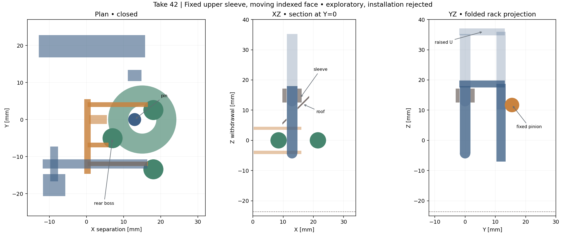

# Take 42 — fixed upper pin sleeve and translating indexed face

**Exploratory. Reject this installation, not the fixed-Z-pin concept.** The six-land carriage passes the upper cheek, sleeve and folded rack through its full sequence. It does not pass its own X motor. In the proposed closed stow the Kin's own tail eye also occupies its joint motor at all three tested working pitches. Thinner seat fingers solve a clearance problem but not the draw-load path. No official evaluation, candidate, requirement change, fabrication or qualification.



## Section and sequence (mm)

- X is forward separation; Z is vertical withdrawal. The XY torus is centred at (15,0,0), major radius 6.50, tube 2.70. Its rear crown is at x5.80. The fixed pin **axis** is (12.95,0); the near inner eye equator and Ø3.50 pin meet at x11.20. Tail includes Ø5.40 bosses at (7,−5.04,0), (18,+2.56,0), (18,−13.44,0), three necks, main stem, fork and articulating joint. No conductive power path through the pin is assumed.
- **Closed:** fixed round port radius 1.85 in roof x9.75..18.60, y±3.80, z=x−4.53 to x−3.88, two upper straps. No long slot, opposing wall, lower bearing, pin-tip catch or lower shoe. Shank runs from z−4.25 to 17.95; hemispherical nose reaches −6.00. Metal sleeve z12.55..17.15, ID/OD 3.60/6.30; top bridge rails and rear web to chassis. Nose is unsupported below the eye.
- **Take up:** from x offset −1.35 drive the indexed face toward +X; zero is nominal loaded geometry, not a fixed preload stroke irrespective of tolerance. Six flats on three V pairs have slopes in XY +1.2, −.8, −.8, tip normals elevated ±58°, sized 1.34 × 1.40 on .66 metal backing. They bear the indexed bosses, not an unindexed torus friction brake. Require actual six-seat capture/attitude and draw force before declaring lock. The drawn lands do **not** all fit the ring at home; see below. No wrench or attitude certificate supplied here.
- **Relieve:** drive the face back to −1.35 with pin down. Positive-powered draw through a series spring/cage, not spring-closed capture; backstop and overload must work independently of a command or motor stall. Relief of commanded compression does not eliminate applied pin load.
- **Withdraw:** hold face back, drive the U +17.25 to a nose at +11.25 (cap centre +13). Normal distance of cap to the roof's rear/outside plane is 1.029 nominal, from sphere-to-plane distance, not just height at x12.95. U crossbar x11.02..14.88, y−1.90..13.15, z17.55..19.85 locked, top **37.10** open. Rack x11.10..14.80, y10.40..13.40, z−7.05..18.75 locked; fixed pinion x11.15..14.70 at y15.50,z11.70, pitch radius 2.40. Its pitch point has 7.05 mm of rack above it locked and 1.50 mm below it open. Engagement depth, end tooth reserve and actual m.30 profile remain unvalidated. Lower/side guards, stop, twin side gibs and back shoe are fixed at low Z; **no fixed tower** at z37.1. The moving upper crossbar is not itself a safe external pinch guard. A complete upper shroud, edge protection and service access are outstanding; no stow or recovery credit for an absent cover.
- **Eject:** only after direct pin-clear confirmation; positively drive the same indexed carriage to +15.25 (16.60 mm from relief). A central face at x5.48 reaches x20.73. In the ideal aligned, maintained-crown-push path a .32 gap closes first; the last rear boss then has xmin19.23, .63 beyond the x18.60 roof mouth. This is displacement under a named contact, not proof the Kin travelled, every part cleared, or the external load is bounded. A free eye need not remain linked after release; loss of pose is not a fault to fix by imposing co-motion.

## Which face can pass?

| Test | Result |
|---|---|
| Entire final moving carriage vs upper Z hardware, including U | +.20 through clamp/relief; +.20 through withdrawal; +.05 through ejection, **after** .20 stock allowance. Limiting ejection pair: roll link/roof side. Swept 3-D solids, not just endpoint pictures. |
| Face tines vs intact aft roof edge | z±4.52 vs roof floor z5.22: .70 nominal at the top. The separate back upper tie extends to z4.62. |
| Full front V land vs loaded torus | Corner (16.838,4.348,−1.919) is .0829 inside the exact ring, before tolerance. Local .55 scale crop on both in-plane pad extents gives >.251 nominal material clearance for that pad and its mirror through aligned −1.35..0 relief, certified by interval/Lipschitz debit. Not installed, and no contact-patch, stem, uncertainty or strength credit. |
| Park jaw/seat plate at relief; independently drive stripper | The fixed land centre (15.396,3.563,−2.570) enters the exact torus by .130 at +5.825 aligned tail travel. A fixed full land is therefore a physical barrier even with the pin gone; it is not the pusher's lack of commanded travel. Shrinking the flat about its face centre does not remove this deep central material. No independently driven third actuator credited. |
| Translate seats with aligned eye | No relative axial sweep across that land on a truly co-translating path; does not cure its home corner. Strip-edge escape, adverse boss/stem/whole-body contacts and off-axis poses remain open. |

Mechanics Take 41's **conditional** near-home eye-only result: Cx=15±.20, Cy=0±.50, tilt ≤3°, intact x9.75/z5.22 edge. Direct roof contacts have n_z≤−.592; pin contacts n_x≤−.812; virtual (−.37,0,−1) gives ≥.0360 and .0432 N/N respectively after the stated 1°/friction debit. This is not an actual trajectory, nor does a pin switch verify the pose. At a roof lip, the tangent rolling-ball centre projects ≤1.85+2.70 sin45°=3.7592 from the pin, below 4.45; the same constituent cannot touch the shank there. The cap centre is then ≥2.381 above that constituent centre or the pin is clear. Another hemitorus, smaller neck, land, fork, floor, cheek support or housing is not excluded. Rounded aft-edge/normal tolerances need a new bound. No lower-port pinch used.

## Pin, sleeve and carriage loads

Steel pin E=205 GPa assumed; elastic, straight Ø3.5 with no notch. Two .70 mm loaded bands at each end of the continuous sleeve, effective contact centres z12.90,16.80 (span **3.90**), opposed radial reactions. No pin-support credit for open rack, crossbar, port edge or rack guide. Uniform band pressure, Coulomb coefficient .23 and rigid bearing backing are **screens**, not verified properties. Beam at z12.55 is the free-section moment; discrete-band bending peaks slightly inside the sleeve. Below deflections are at the load, perfect lower-edge clamp / two opposed narrow simple supports, before radial slack or chassis flex. Load vector is force on the pin at its x−1.75 side. Mixed row is an explicit one-sided example compatible with μ=.23, not an extremum over all possible forces.

| Applied force (N); contact z | Free-edge bending / twist (N·mm, magnitudes) | Nominal equiv. stress (MPa) | Deflection (mm) | Opposed band loads (N) | Sleeve drag (N) |
|---|---:|---:|---:|---:|---:|
| (121,0,0); 0 | 1519 / 0 | 361 | .053 / .075 | 521 / 400 | 212 |
| (131.55,0,0); 0 | 1651 / 0 | 392 | .057 / .081 | 567 / 435 | 230 |
| (131.55,24,−18); −3 | 2110 / 42 | 503 | .114 / .151 | 687 / 553 | 285 |
| (5,0,0); 0, *if relieved* | 63 / 0 | 14.9 | .0022 / .0031 | 21.5 / 16.5 | 8.76 |

For a pure central F, opposite reaction F·12.90/3.90; loaded band reaction adds F. At 121 N the discrete-band maximum moment is 1561 N·mm (371 MPa). Average projected pressure 213/163 MPa, mixed one-sided 280/226 MPa; edge peaks could be higher. Using band edges instead of centres puts the 121 N sleeve-drag estimate between 180 and 258 N. There is room to rock: .05 radial bore clearance extrapolates to .381 at z0; the forward roof rim at z10.27 can see .124 displacement including bending, vs .10 radial port clearance. **Rim rubbing and redistribution cannot be excluded**; do not add a helpful support with zero friction. At full park the shank-to-cap transition reaches z13: the lower band is not fully cylindrical then. High loaded-band numbers apply to engaged positions, not the whole release. No yield, life, taper or extraction-force certification.

Comparator only: two symmetric 2.55 mm journals at |z|12.55..15.10, centres span 27.65. Ø3.50 central load 131.55 N gives simple-support .038 mm, 216 MPa. Locked tip z−17.05 would put shank to −15.30; lifting to +11.25 takes 28.30, and the far bore/cheek adds release obstacles. Not a full two-cheek package and not used to rate the final pin.

**The moving face is a second load path, not a free clearance win.** Individual ungusseted fingers at z±4 are only 1.26 wide × 1.04 thick just beyond their shared rear tie. Compute each land's most favourable normal moment arm over its entire flat; with nonnegative loads and prescribed axial sum, at least one root moment is ≥ draw / Σ(nₓ/min|mᵧ|). No equal-share assumption, no friction relied on. At 65.5/131.55 N the resulting minimum largest moments are 168/338 N·mm: nominal stresses ≥742/1490 MPa (section modulus .227 mm³). These draw cases are sizing inputs, not new criteria. Concentrated patch/fillet and join stresses, capture at minimum draw and real fixture reactions are additional. Neither this thin rail nor PA12 should be counted as a qualified metal preload path.

## Drives, power and controls

X: M2.5×.45 screw along y−12,z12.7 with two thrust/radial support allocations; moving nut, spring cage, paired guide carriages on Ø1.7 rails separated in Y, worm wheel, independent clutch and output brake drum/pawl/lifter. Z: Ø6 × 28.7 geared motor, two spur stages, rack pinion, journals, clutch, output dog/drum and lifter, rack stops/gibs and shank/clear detectors. Registry is not the force limiter. Ball screw efficiency, irreversible worm action or indefinite motor stall are not assumed.

- X screen: 17.47 mm drive offset and 7.88 mm carriage span. A central 15 N push needs ~25 N screw thrust, 10.5 N·mm screw torque, 2.21 N·mm at geared input assuming guide μ=.15, thread μ=.18, thrust μ=.08 and worm efficiency .65. Draw 131.55 N gives 219 N, 92.3 N·mm and 19.4 N·mm respectively. This is one ideal two-reaction guide model, not a jam bound or guaranteed eject force. Actual thrust friction, force centre, misalignment, spring rate/compression, dog capacity, root and gear tooth loads are unqualified.
- Z screen: 2.4 mm pitch radius, 10.38:1 post-gearhead train, efficiency .80. With 121 N residual transverse load, sleeve and eye alone imply ~240 N rack demand or 69.3 N·mm gearhead torque. With residual limited to 5 N, ~9.91 N / 2.86 N·mm; **no verified residual limit**. Compare the [prior Maxon GP6A catalogue](https://www.maxongroup.com/medias/sys_master/root/9406823596062/Cataloge-Page-EN-412.pdf) 30 N·mm continuous: motor fits neither full-load extraction demand nor a low-cost claim by assumption. At 5670 rpm and ~221:1, provisional Z stroke ~28 s, X full stroke ~10.6 min; supply, startup, duty cycle, thermal and battery life not established.
- Both outputs require overload limiting upstream of a load-side mechanical hold, powered release of hold, and actual stop engagement, not a software angle. On relief require actual face/unload state; before ejection require actual shank clearance independent of actuator turns. At y±2.75 the opposite optical allocations provide a cross-pin beam near z10.9; a clear beam plus retract-end witness would discriminate the nominal seated nose from a true retract. A single beam is not a fracture, bend or tail-departure detector. Home pin presence plus independently verified seat capture/load and engaged output hold are required before declaring lock. Loss/contradiction of a flag inhibits ejection or declaration. Stroke stops, dog tooth shapes, armatures, flag targets, force-spring calibration, capture/pose/departure sensing and safety coverage **not closed**.
- The stock model includes cell, MCU, paired-driver allocation, cutoff, connector, control-wire channel, yaw drive/pinion/sector/hinge, four feet, two clutch/dog/lifter bays, force/direct slide pickup and pin detectors. Small control bodies are packaging allocations, not selected parts. Final spring pickup itself lacks the .20 allowance to its moving cage; its body is unseparated from the X motor. Final wiring, independent joint driver/power budget, shell/foot and motor mounts, boot, fasteners and tool access not demonstrated. The fixed front/back pads need actual stops and tolerance stacks, not a motor coordinate.

## Stow, neighbours and material witnesses

| Pitch | Locked nominal outer diameter at chosen centre | Sphere centre (x,y,z) | Own ring centreline depth into conservative Ø6 joint-motor core, zero yaw |
|---:|---:|---|---:|
| 33 | 57.974 | (−1.290,−.015,+.295) | Not used for the neighbour sweep |
| 35 | 58.390 | (−2.100,+.540,−.125) | 2.443 |
| 36 | 59.037 | (−2.835,+.835,−.295) | 1.950 |
| 37.5 | 60.113 | (−3.835,+1.065,−.300) | 1.040 |

These are enclosing diameters of **overlapping stocks** at chosen centres, not minimum-diameter impossibility proofs or achievable Ø60 stows. Floor at z−23.65 on four feet; cell bottom −21.95, nominal 1.70 above floor. Nose bottom −6, no fixed lower cheek exists. The upper U may legitimately leave the stowed sphere on opening; that does not remove neighbour or shroud checks.

1. **Parked X motor vs cell:** (−8.75,−15.10,−17.60) is inside the cell and .400 inside modeled Ø6 motor radius. **Relieved guide vs same motor:** (−7.90,−15.90,7.70) lies outside the master rail bore in moving carriage stock and 1.009 inside motor radius. Neither is an intentional mesh, nor fixed by pitch.
2. **Own torus vs motor:** at pitch 36 the actual centreline point (−17.468,−5.457,0) lies 1.950 inside the joint motor's Ø6 core in the neutral stow. This uses the exact torus, not a capsule proxy. No translated head rescues the tested motor clocking across those pitches.
3. **Failed recovery:** at zero yaw, held neighbour (no assumed departure), pitch 36 and +13.15 carriage offset, the rear V land centre (19.122,−6.273,2.570) lies 2.932 inside the next Ø6 joint motor. Same depth at pitch 35/+12.15 and 37.5/+14.65. This rejects unconditional recovery, not an already measured, sufficiently receding neighbour. Closed next Z motor/pinion at +15° also remain unseparated, not automatically a material collision.
4. Stage calculator tests both heads' clamp, withdrawal and eject envelopes in all nine combinations, yaw ±15° with angular interpolation debit and independent departure enclosure 0..15.25; own tail/sector yaw ±15°. Convex translation sweeps are continuous. Positive projected gap is sufficient; negative result alone is **not** penetration depth. Intended screw/nut, rail/bore, sleeve/shank and gear/rack fits cannot be declared collisions by overlapping proxy bodies. Crossbeam and sleeve-root rails overlap as fixed stock; could be a designed common frame, not a repair of the motor or moving-carriage conflicts.

## Reproduce

Python 3 standard library, except optional drawing. From this directory run each entry with its supplied dependencies (the earlier Take 28/32 geometry helpers are unchanged):

```sh
for stem in fixed-z-take42 fixed-z-route-take42 fixed-z-stage-take42 fixed-z-witness-take42; do
  python3 -B "$stem.py" || exit 1
done
MPLBACKEND=Agg python3 -B fixed-z-section-take42.py  # optional matplotlib
```

The first two scripts are superseded one-cheek routing attempts (16.15 lift); stage and witness scripts are the final 17.25 lift. The original translating screw fouled the bulkhead; the routed screw/roll-bar variant still fouled joint hardware. Geometry calculations are deterministic comparisons of designed solids, not measurements of purchased hardware or solver-native acceptance loads. Q85/Q100 and ENV-004 are unchanged. No Gate 1, qualification, commit, push or PR.
