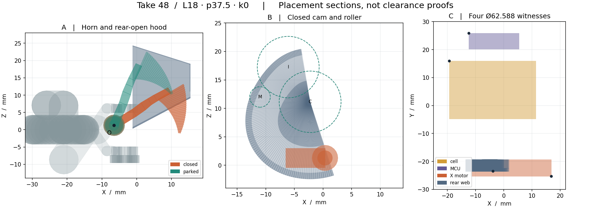

# Take 48 — rotating horn, split trunnions and captive cam

**Exploratory. Reject this allocation; retain the L18 split-pivot geometry for iteration.** At p37.5, k0 the horn moves past the thick own tail, joint and moving face. The complete head does not fit Ø60; the forward hood and rear garage also have independent material crossings. Nothing here establishes loaded release, a rated actuator, fabrication readiness or an official result. Q12, Q85 and Q100 are unchanged.

## Hand-off: change these parts first

1. **Move both electronic/drive pairs, not just the hood.** The upright MCU corner (−12.40,25.85,10.50) and X motor rim (16.90,−25.11908,−6.80556) are **61.285 mm apart**. Independently, the two cell corners at x=−19.33 and +11.33, y=15.95,z=−22.10 and the closed cam rear-web point (−3.89431,−23.50,19.86840) need **Ø61.679**. These results assume the cell and MCU occupy their reserved rectangular stock; new board shapes or placements require new checks. Neither proof uses a gear addendum disk, full round cam blank, or arbitrary sphere centre.
2. **Reroute the registry and hinge.** Lead's short, rear-open hood is installed as supplied. At home, (5.50,6.51,10.00) is 0.10 mm inside its +Y skin and 0.45 mm inside the upper bridge. The overlap persists under a common k shift. At k0, (0,−4,1.15) is 0.199 mm inside the floor in the Z direction and 0.75 mm inside the fixed elbow. Do not simply cut a hole: the lower surface must remain guarded and drafted.
3. **Recess the rear closure around the lug.** The rear garage is joined at x−1.15 with internal spoke passages, not a lateral exit. Its trial end panel at (−1.05,0,6.15) crosses the upper hinge lug: radius 2.45 is between 1.57 and 3.65, while that point is at least 3.549 mm outside either duct allocation. Cutting only the two spoke passages does not remove the collision. A continuous alternative garage must exclude the real lug sweep, not cap the rear opening or expose the linkage.
4. **Do not count registry stroke as separation.** At straight alignment, two 34.25 mm moving X rails first meet after 3.25 mm if the neighbouring body has not advanced. At +16.8 mm they overlap 13.55 mm at (21.575,−9.60,−15.65). The same crossing is absent at the aligned co-advanced endpoint. A shorter rail, differently routed propulsion, or a physically guaranteed clearance-versus-travel condition is needed for this recovery case.

## Axis, supports and body

World mm; +X separation, transverse axle +Y, upward +Z. For each L, O=(11.5001814182−L,0,1.28005805+k); positive φ about −Y. The exact horn uses the supplied solid disks: Rc=L+.9, g=.32L/(Rc+.9), f=(Rc+.9)exp(gt)−Rc; lo=log((Rc+.22)/(Rc+.9))/g. L18 hi/park=.54/.62 rad, L20=.50/.56. The calculator encloses the material with circumscribed cross-sections, monotone radius bounds and chord-sag padding; a failed separating plane alone is not penetration.

L18 through-shaft: (−6.25,0,1.28) is inside both Ø3 shaft and stationary knuckle. L20 through-shaft at p37.5: its axis at (−8.49982,0,1.28006) lies 3.262 mm from the nearest straight thick stem segment, inside the R4.2 capsule. At p36 the through shaft is worse. The preliminary L/k comparison in the core output used the earlier thin stock; do not transfer its positive margins. The final model uses Take 46 R4.2 capsules on **all** pre-fork segments, reconnects each R1.45 fork to its fixed elbow, and retains the articulated sector and lugs.

Selected O=(−6.49982,0,1.28006), p37.5. Split swept spokes join the buried t=.54 end to integral trunnions. The final two paths narrow on the *outer* face at r6.8 (centre |y|6.87, width 1.90), leaving the hinge region open. Forward of the rear plane, the swept spoke stock clears the inner hood sides by ≥0.253 mm nominal. Rear ducts use swept outer allocations (+.22 running clearance +.30 skin), end housings and bearing passages; the boundary of their union minus the running lumen is the proposed skin, not a solid web filling the channels. No claim of a sealed installed assembly: the rear panel/upper lug obstruction stands.

Driven stub Ø5, Ø6.1 root collar; two Ø5 ID/Ø8 OD bearing bands at |y|11.25..13.55 and 14.05..16.35, housing Ø9.4. Opposite stub Ø3, two Ø3 ID/Ø6 OD bands at 9.45..11.95 and 13.60..16.10; Ø7.6 housing. This reserves duplex supports; these are **not** catalogued or rated bearings. Cheek returns meet stationary frame stock intentionally; fasteners, thrust shoulders, installation access and seals are not established. The joint keeps its 18:42 × 18:72 reduction; motor (x,y)=(3.70,13.35), compound (−3.50,11.25). The previous gravity screen was 112.4 N·mm at p36, 115.5 at p37.5; the 157.3 N·mm illustrative fault is not a fitted limit.

## Captured positive drive and load sensitivity

Cam axis C=(−2.25,11.15) and horn motor M=(−11,12) in **XZ**, axes along Y; idler (−6.074,17.251). Two m=.20, 18:54 external meshes give 9:1. For lever radius 6.85, roller centre is O+6.85(cosφ,sinφ) in XZ. Cam-frame path = rotate(roller−C,−θ); closed dwell θ=0..25°, then 132° cycloidal rise and 23° open dwell. Ø4.50 roller, normal offsets ±2.31 make two driven flanks; outer radius from path +3.36, rear web thickness 1.15. Sampled min curvature radius 6.037, minimum output arm 5.717 and closed arm 6.624 mm. The generated groove strips are a section model, not cutter compensation. Angular end caps, hard stops, runout, impact, contacts, tolerances and ratings need detail.

Closed load is backed by groove flank → web → camshaft/bearings → frame. Ideal concentric dwell makes zero input torque; in addition a square-flank index tongue enters a shaft flange, so nonzero eccentricity need not be held by worm friction or motor braking. A body/guide, through-keyseat specification and retraction sweep are reserved. Bias inserts the tongue; it does **not** close the coupler. Actuation force, tongue lift, return, support and independent sensed engagement remain unverified. Sequence: with horn indexed, power X take-up against measured downstream force; positively hold upstream of series stack. On release reapply X load, lift X pawl, relieve, then physically retract cam index, lift horn into open dwell, and physically advance registry/pusher. Keep independent position/force monitoring: no switch, current or command proves unloading, true pin clearance, neighbour travel or release.

At Fx163, lead's two example friction equilibria give **246–1742 N·mm**, not 939 alone. For G=79 GPa at the larger torque, the Ø5 span alone twists .117° (71 MPa nominal shear). Including 1.90 mm of Ø6.10 collar gives .135°; one-sided .06 mm groove clearance plus twist is **.205 mm** at an 18 mm pole before boss, spoke, bearing and frame deflection. Reversed groove play alone is .326 mm. Output roller ≈263 N; 5.70 mm overhang and 2.80 mm band spacing give **798/535 N opposite** band reactions from this force alone, 1.499 N·m shaft bending and ≈122 MPa nominal bending stress. Other horn contact and thrust loads are additional, not assumed shared. A .05 mm dwell eccentricity gives 13.15 N·mm at the cam and 3.70 N reference on the R3.55 index tongue. A pure 1742 N·mm couple through one narrow spoke section would produce 955 MPa; this is section sensitivity, **not** a solved spoke wrench or a necessity proof. If the extreme torque persists into the worst rise, the gearhead needs ≈130 N·mm at .80 external efficiency; final mesh tangential load ≈174 N. No rated gearhead, teeth, cam surface, roller pin, spoke or bearing follows.

**Separate X drive:** m=.20 18:54 gearing, M3×.5 screw, upstream hold rail, series pack, downstream 3.2×2.8 metal stalk. Slide bands at x−4.50/+8.60 constrain a moving 5.70×3.60 rail; screw at (y,z)=(−17.8,−11.4). At centred pure Fx, guide couple uses the screw offset and 13.10 mm loaded span. The calculator sums the orthogonal band reactions, with worst reinforcing guide-drag moment; assumed μ and efficiencies are sensitivities, not measurements.

| Face Fx (N) | Screw thrust N, μ=.10/.23 | Gearhead N·mm, .28 screw/.80 gears | Nominal stalk peak fibre MPa |
|---:|---:|---:|---:|
|155|240 / 437|28.5 / 51.8|643|
|163|253 / 460|29.9 / 54.5|676|
|200|310 / 564|36.7 / 66.8|829|

At 163 N the μ=.23 scalar normal sum per band reaches 646 N. These are not a six-face fault solution; torsion, pad slip, preload, backlash, tooth holding/bearing stress, screw stability, motor efficiency, calibrated strain/stack travel and power dissipation remain open. No assumption that 76 N is enough.

## 3D allocation checks

Closed/working/ejecting horn and lever vs synchronized moving registry give nominal separating margins **1.532 / 1.417 / 3.594 mm**. With a .20 mm stock debit plus yaw interval debit, the revised split rotor vs own thick tail is ≥.488 mm; bearings/carriers ≥.122. Horn motor relocation clears the enlarged upper neck across ±15°. The yaw drivetrain/sector clearance outside intended mating categories is .150 mm in its screened subset. These do not imply guard or loaded operation clearance. Neighbour head/body endpoint checks over ±15° after allowances: closed/closed ≥.073, eject/closed with co-advance ≥.183, closed/eject (next extended) ≥.037, eject/eject with co-advance ≥4.373 mm. The held-neighbour crossing is real. No trajectory or unlinked attitude guarantee between these endpoints.

| Whole interface offset k (mm) | Diameter lower bound (mm) | Floor margin (mm; z−23.65) | Split-spoke screen vs own tail |
|---:|---:|---:|---|
|0|62.588|+.15|+.488 mm|
|−3|62.714|−.35|Unseparated at lug|
|−5|63.365|−2.35|Unseparated at lug; cell/boss also flagged|
|−7|64.160|−4.35|Unseparated at lug; even non-electronic lower bound 61.061 mm|

Each bound uses convex-weighted variance of actual points of the declared stock; adding unmodelled leads, mounting screws, flags, thermal space, or fabrication allowances can never lower it. At k0 the four supporting points/weights are the cell (−19.33,15.95,−22.10)/.236818, MCU (−12.40,25.85,10.50)/.277016, X motor (16.90,−25.25442,−6.30045)/.354842 and **actual web** (−3.89431,−23.50,19.86840)/.131324. With both cell and MCU omitted the selected points provide Ø58.322 only — **not** proof of a fit. Fixed components make the two-stock MCU/motor exclusion independent of joint articulation and commanded horn phase. The upper enclosure in the raw output encloses modelled stock plus conservative blank/sweep allocations; it is not an achievable stowed diameter.

## Use the model

From the study directory: `g=runpy.run_path('horn-package-take48.py')`. Use `tail48(p,k), joint48(), face3(), xmove(), xfixed(), horn(18,0,φ), fork5(φ), che5(), camstock(θ), lever(φ), indexdog(), duct(), roof48(), packageElec()`. `fixed48()` returns fixed stocks including the cam's full rotation envelope but excluding electronics/feet. Generate the grouped JSON in world coordinates, k0, with `python3 -B horn-model-take48.py` (NumPy/SciPy/Matplotlib). For offset studies translate head/registry/garage/drive by (0,0,k), use `tail48(p,k)` (root reconnects), leave joint/feet/electronics fixed. Reported alternatives do not claim remounted support connections. A group containing “blank/envelope/sweep” is not all material; do not union closed and parked JSON groups. Cam slots and aligned shaft/bearing/thread passages are deliberate. Full machining bores, closed wire routes, switches, compression-dependent pack pose, all internal self-interferences and fault recovery are not solved. Run the core, layout, install and package scripts here with CPython, NumPy and SciPy; compare stdout to each named results text. This study changes no candidate or official result.
